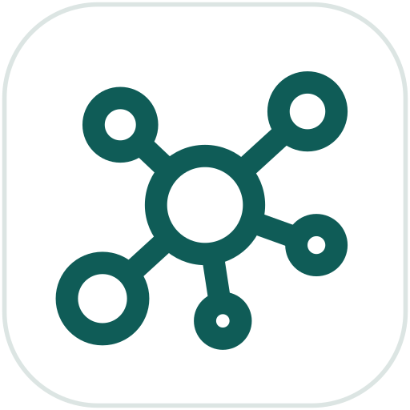

<p align="center">
  
</p>

<h1 align="center">MeshPort</h1>

<p align="center"><b>Pay people, not addresses.</b><br>
Self-custodial USDC payments and private chat, on Arc and 20+ chains.</p>

<p align="center">
  <a href="https://meshport.xyz">Website</a> ·
  <a href="docs/SELF_CUSTODY.md">Self-custody</a> ·
  <a href="docs/CHAT_ENCRYPTION.md">Encrypted chat</a> ·
  <a href="docs/ARCHITECTURE.md">Architecture</a> ·
  <a href="https://x.com/meshport_xyz">X</a>
</p>

> **Arc Testnet only.** Every chain, contract and RPC endpoint here points at a testnet.

---

## What's inside

### 🔐 MeshPort Wallet
A self-custodial wallet. Create a new wallet or import one with your recovery
phrase or private key. The key is generated and kept on your device, locked
behind a 6-digit passcode (with optional fingerprint / Face ID unlock), and
never sent to or stored by MeshPort.
→ [How self-custody works](docs/SELF_CUSTODY.md)

### 💬 Chat & Pay
Message anyone by their `.arc` username and send money in the same thread.
Chats are **end-to-end encrypted**, with every chat key signed by its wallet.
→ [How chat encryption works](docs/CHAT_ENCRYPTION.md)

### 🌐 Multichain Hub
One balance on Arc, reachable from 20+ chains: bring USDC in, send it out,
track every step. Built on Circle Gateway and CCTP V2.

### 🧾 Payment links & business accounts
Shareable links (`meshport.xyz/paylink/you?amount=10`) with rich previews,
QR payments, business bills, bulk payouts, swaps (USDC · EURC · cirBTC) and P2P
trading with on-chain escrow.

## Self-custody at a glance

```
create / import wallet ─► key kept on your device ─► passcode (+ optional biometric)
```

| MeshPort stores | MeshPort never stores |
|---|---|
| Wallet address, username, profile | Private keys or seed phrases |
| Public account data | Your passcode or the key it unlocks |

## Build

```bash
git clone https://github.com/0xsuneel/meshport.git
cd meshport
npm install
npm run dev          # http://localhost:5173
```

```bash
npm run typecheck    # TypeScript
npm run lint         # ESLint
npm run test         # Vitest
npm run build        # production build
```

You'll need a Supabase project and a `.env` — see
[Local development](docs/ARCHITECTURE.md#local-development).

## Repository map

| Path | What it is |
|---|---|
| [`src/`](src) | React + Vite PWA — wallet, chat, pay, multichain, business, P2P |
| [`src/lib/`](src/lib) | Wallet security, chat crypto and payment logic |
| [`src/blockchain/`](src/blockchain) | Balance readers, RPC providers, chain config |
| [`api/`](api) | Vercel functions — link previews, relayer, profile, push |
| [`supabase/functions/`](supabase/functions) | Edge Functions — claims, accounting ledger, business pay (`merchant-pay`), indexer |
| [`supabase/migrations/`](supabase/migrations) | Database schema and row-level security |
| [`contracts/`](contracts) | Solidity — rewards, P2P escrow, bridge router |
| [`docs/`](docs) | Architecture, self-custody, chat encryption, audits |

## Names in the app vs. names in the code

The app has two account types, **Personal** and **Business**. Some code and
database names are older than the app's wording; they mean the same thing:

| In the app | In code and the database |
|---|---|
| Business account | `merchant` (`useMerchant`, `isMerchant`, `merchant_*` tables, `merchant-pay`) |
| Business verification | `merchant_applications` |
| Cross-chain Transfer (business) / Multichain Hub (personal) | `/multichain`, `MultichainPage` |
| Business Insights | `/business?screen=reports`, `BusinessInsightsPage` (desktop) |
| Manage money · money on other chains | `BusinessMoney`, Unified Balance; payment status `in_ledger` = waiting on another chain |
| Bill · Request · Shop QR payment | `merchant_payment_intents` (`kind` = `invoice` is a bill; `via` = `shop_qr` is a Shop QR payment; otherwise a request) |

The `ledger` folders and `ledger_events` table (`server/ledger/`,
`supabase/functions/ledger-interpret/`) are the internal accounting record
that Activity is built from. It is never shown in the app.

## Tech

React · TypeScript · Vite · Tailwind · viem · Supabase · Vercel · Circle
Gateway & CCTP V2 · WebAuthn biometric unlock · Argon2id · X25519 / AES-256-GCM

## Contributing & security

Contributions are welcome — see [CONTRIBUTING.md](CONTRIBUTING.md).
Please report security issues privately rather than in a public issue.

## License

[MIT](LICENSE)
